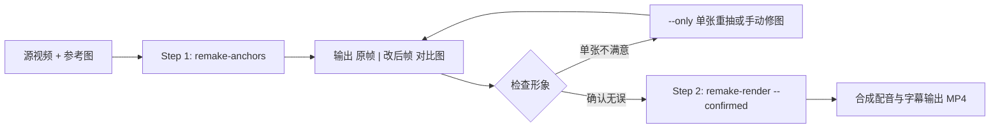

# H3 Studio Colab

<p align="center">
  
</p>

<p align="center">
  <a href="https://github.com/Kiteflyingee/h3-studio-colab/actions/workflows/ci.yml"></a>
  
  
  <a href="LICENSE"></a>
</p>

调用 Google Colab 云端 GPU（或通过 `--backend local` 连接本地环境），完成**短视频换人/换商品改版、多镜头分镜生成、配音合成与字幕替换**。

这个仓库同时支持两种使用方式：
- **作为 AI Agent Skill 安装**：装进 Antigravity、Claude Code、Codex、Cursor 等支持 Skills 的工具里，通过 `/h3-studio-colab` 或自然语言对话自动编排任务、出关键帧对比图确认并渲染成片。
- **作为独立 CLI 工具运行**：直接在终端执行 [`scripts/h3studio.py`](scripts/h3studio.py) 子命令，手动控制每一步参数与会话。

<p align="center">
  
  <br />
  <sub>实机复刻演示：两步确认式关键帧对齐 + WepeNerd H3 Ripple 6 步扩散（上：原片 · 下：双猫设定图替换成片，1:1 保留逐帧动作与背景）</sub>
</p>

---

## 为什么做这个项目

平时在 Colab 网页里手动开笔记本跑视频工作流有几个很烦的问题：每次重开都要重新配节点和拉几十 GB 权重、网页断连容易丢进度；尤其是做视频改版时，经常等整条视频跑完才发现人物脸崩了或者背景变形了，白白浪费时间和算力点。

这个仓库把平时常用的一套视频制作流程收到了一个本地脚本 [`scripts/h3studio.py`](scripts/h3studio.py) 里：

- **视频改版拆成两步，先看图再跑片**：第一步 `remake-anchors` 只切镜头并改首尾关键帧，几十秒就能把「原帧 | 改后帧」对比图拉回本地检查（未改动区域会自动做仿射对齐还原背景）。哪张不满意可以加 `--only` 单独重抽或自己修图覆盖，确认没问题后再跑第二步 `remake-render` 生成整段视频。
- **热机会话默认保留 15 分钟**：跑完一条命令后云端实例不会立刻销毁，下一条命令带上 `--session` 就能直接复用显存里已经加载好的模型；全部跑完执行 `stop --all` 立即关机省点数。
- **可独立跑单件素材或纯 CPU 后期**：除了整片改版和多镜头编排，单张生图/改图、首尾帧生视频、多图参考生视频、配音生成、指定秒数贴配音、擦除原字幕重压新字幕都能单独调用。只改字幕或配音时不会启动 GPU（macOS 上用 Homebrew 标准版 `ffmpeg` 缺 `libass` 时会自动退回透明 PNG 叠字）。
- **锁死权重哈希与断点恢复**：[`models/catalog.json`](models/catalog.json) 和 [`dependencies.lock.json`](dependencies.lock.json) 固定了模型 revision、SHA256 与节点 commit，避免上游更新把工作流改坏；中途网络断了加 `--resume` 可以接着跑。

---

## 安装与环境准备

无论是给 AI Agent 当技能调用，还是自己在终端敲命令行，本机都需要 **Python 3.10+**、`ffmpeg` 以及登录好的 [`google-colab-cli`](https://pypi.org/project/google-colab-cli/)：

```bash
uv tool install google-colab-cli
colab auth login
```

### 方式一：安装为插件或 AI Agent Skill

仓库采用**插件市场（Plugin）与独立技能（Skill）双兼容目录结构**，内置了 Claude Code（[`.claude-plugin/`](.claude-plugin)）、Codex（[`.codex-plugin/`](.codex-plugin) 与 [`agents/openai.yaml`](agents/openai.yaml)）以及 Antigravity（[`plugin.json`](plugin.json)）的描述文件，既可以用各客户端自带的插件命令直接添加，也可以克隆到 `skills/` 目录使用：

| 客户端 | 插件安装路径 / 命令 | 单 Skill 目录路径 | 对话调用方式 |
| :--- | :--- | :--- | :--- |
| **Claude Code** | `/plugin marketplace add Kiteflyingee/h3-studio-colab` | `~/.claude/skills/h3-studio-colab`（项目级 `.claude/skills/`） | `/h3-studio-colab` 或自然语言 |
| **Codex** | `$skill-installer install https://github.com/Kiteflyingee/h3-studio-colab` | `~/.codex/skills/h3-studio-colab`（项目级 `.agents/skills/`） | `$h3-studio-colab` 或自然语言 |
| **Antigravity** | `~/.gemini/config/plugins/h3-studio-colab` | `~/.gemini/config/skills/h3-studio-colab`（工作区 `.agents/skills/`） | `/h3-studio-colab` 或自然语言 |

**Claude Code 安装**

直接在 Claude Code 对话框中通过插件市场添加并安装（首次使用前记得在插件目录或本机 Python 环境中执行一次 `pip install Pillow huggingface_hub`）：

```text
/plugin marketplace add Kiteflyingee/h3-studio-colab
/plugin install h3-studio-colab@h3-studio-colab
```

或手动克隆到技能目录：

```bash
git clone https://github.com/Kiteflyingee/h3-studio-colab.git ~/.claude/skills/h3-studio-colab
pip install -r ~/.claude/skills/h3-studio-colab/requirements.txt
```

**Codex 安装**

在 Codex 对话中直接调用内置技能安装器：

```text
$skill-installer install https://github.com/Kiteflyingee/h3-studio-colab
```

或手动克隆到 `~/.codex/skills/`（单仓库安装可改为 `.agents/skills/h3-studio-colab`）：

```bash
git clone https://github.com/Kiteflyingee/h3-studio-colab.git ~/.codex/skills/h3-studio-colab
pip install -r ~/.codex/skills/h3-studio-colab/requirements.txt
```

**Antigravity 安装**

可作为完整 Plugin 安装到全局插件目录（在插件面板中带图标、推荐提问卡片并支持一键启停）：

```bash
git clone https://github.com/Kiteflyingee/h3-studio-colab.git ~/.gemini/config/plugins/h3-studio-colab
pip install -r ~/.gemini/config/plugins/h3-studio-colab/requirements.txt
```

也可以仅作为单工作区 Skill 放入当前项目：

```bash
git clone https://github.com/Kiteflyingee/h3-studio-colab.git .agents/skills/h3-studio-colab
pip install -r .agents/skills/h3-studio-colab/requirements.txt
```

**通用 `skills` CLI 安装**

```bash
npx skills add Kiteflyingee/h3-studio-colab
```

**安装后在 Agent 对话里怎么用**

装好后直接用对应工具的技能指令唤醒，或者把源视频、参考图路径发给 Agent 描述需求，Agent 会按 [`SKILL.md`](SKILL.md) 里的流程自动生成配置并调用底层脚本：

- **视频换人 / 换商品**：例如 *「把 `source.mp4` 里的主角换成 `role.png`，手里的瓶子换成 `product.png`，保持原视频镜头和背景」*。Agent 会自动先执行第一步切镜并生成「原帧 | 改后帧」对比图发给你检查，不会上来直接跑全片；某张关键帧不理想可以直接让它单张重抽，确认无误后再复用同一台热机合成整片。
- **画风重制或原创短片**：例如 *「参考这两张设定图把原视频重制成 720P 2D 动画风格」*，或者 *「按这段分镜脚本出一条 3 镜头短片，先编译时间线给我看」*。
- **算力保护与会话收尾**：涉及 2 个及以上视频镜头渲染时，Agent 会先和你确认分辨率和镜头数再执行；成片跑完后会询问继续保留热机还是立即关机释放 Colab 会话。

### 方式二：作为独立 CLI 工具安装

不通过 AI Agent、直接在终端手动运行时，克隆仓库并安装依赖即可：

```bash
git clone https://github.com/Kiteflyingee/h3-studio-colab.git
cd h3-studio-colab
pip install -r requirements.txt

# 检查 Colab 登录态与剩余计算单元
python scripts/h3studio.py check
```

---

## 常用工作流

### 1. 已有视频换人 / 换商品改版

复制 [`examples/remake-v3.json`](examples/remake-v3.json)，填好原视频路径、要替换的人物/商品参考图以及字幕信息：



```bash
# 第一步：切分镜头并生成关键帧对比预览（*_compare.jpg），先检查人物和商品效果
python scripts/h3studio.py remake-anchors examples/remake-v3.json --gpu L4 --allow-unverified

# 如果只有某一张关键帧不满意，复用当前会话单独重抽这一张即可：
python scripts/h3studio.py remake-anchors examples/remake-v3.json --session <SESSION> --only remake_001_anchor1 --allow-unverified

# 第二步：确认关键帧没问题后，复用同一台热机渲染整片并合成字幕/配音
python scripts/h3studio.py remake-render examples/remake-v3.json --session <SESSION> --confirmed --allow-unverified --output final.mp4
```

补充说明：
- **整体换画风（如真人视频重制成 2D 动画角色）**：在配置里把 `"mode"` 改成 `"recreate"`，不需要跑第一步关键帧对齐，脚本会自动把零碎短镜头合并到 `6~9.4s` 并压一份 `640p` 静音参考视频提速，直接跑 `remake-render` 即可。
- **只改字幕或画面叠字**：配置里不填 `characters` 和 `products`、只填 `copy` 时，会自动在 CPU 上直接批量出片，不消耗 GPU 点数。

<details>
<summary>查看 <code>examples/remake-v3.json</code> 配置示例</summary>

```json
{
  "source_video": "assets/source.mp4",
  "mode": "edit",
  "resolution": "480P",
  "characters": [
    {
      "target_id": "the woman on the left wearing a red coat",
      "reference": "assets/character.png",
      "prompt": "Keep natural pose and expression."
    }
  ],
  "products": [
    {
      "target_id": "the bottle in her right hand",
      "reference": "assets/product.png",
      "prompt": "Preserve the product shape and original hand grip."
    }
  ],
  "preserve": ["camera", "background", "timing", "audio"],
  "copy": {
    "subtitles": [{"start": 0, "end": 4, "text": "替换后的准确字幕"}],
    "in_scene_text": [{"start": 0, "end": 4, "text": "NEW PRODUCT", "x": 20, "y": 50, "font_size": 32}],
    "clear_regions": [],
    "dialogue": []
  }
}
```

</details>

### 2. 原创多镜头短片

适合从头写分镜脚本出一条完整短片。可以先在本地生成交互式 `timeline.html` 检查每个镜头的时长和衔接（相邻镜头需要连拍动作时可设 `"continue_previous": true`），确认后再推上云端渲染合成：

```bash
python scripts/h3studio.py director-compile examples/director_example.json
python scripts/h3studio.py director-render examples/director_example.json --gpu G4 --confirmed --allow-unverified --output story.mp4
```

### 3. 单件素材生成与后期处理

写一个简单的 `{"jobs": [...]}` 任务清单（参考 [`examples/basic-v3.json`](examples/basic-v3.json) 和 [`examples/advanced-v3.json`](examples/advanced-v3.json)），用 `run` 子命令执行，不同任务之间可以用 `@任务ID` 引用上游产物：

```bash
python scripts/h3studio.py run examples/basic-v3.json --gpu L4 --allow-unverified

# 只重跑某个节点，并顺带更新依赖它的下游任务
python scripts/h3studio.py run examples/advanced-v3.json --session <SESSION> --confirmed --allow-unverified --only animate --with-dependents
```

支持的任务类型（`type`）：
- `image`：文生图或多参考图改图（最多 8 张参考图，设 `align_to_first: true` 可锁住第一张图的背景）。
- `video`：支持纯文本（`text`）、指定首尾帧（`frames`）、多素材自由参考（`ref`）、按秒卡画面（`guides`）、控制视频（`control`）以及镜头续拍（`extend`）。
- `video_edit`：对切好的单段视频传入改好的关键帧列表 `anchors`，扩散到整段视频。
- `tts`：根据文本和最多 3 段参考音频生成 2–15 秒配音。
- `voice_replace` / `subtitle_replace`：将配音贴入指定时间段、擦除原视频固定区域字幕并烧录新字幕。

---

## Colab 会话与 GPU 使用建议

```bash
python scripts/h3studio.py sessions                        # 查看正在运行的会话和倒计时
python scripts/h3studio.py keep --session <NAME> --minutes 60  # 延长热机保留时间
python scripts/h3studio.py stop --all                      # 不用时立刻关机，避免空转扣点数
```

- **机型选择**：平时测提示词、抽关键帧对比图用 `L4`（默认跑 `480P`）最省点数；正式出 `720P` 多镜头成片建议用 `G4` 或 `A100`（未手写分辨率时 `G4 / A100 / H100` 默认走 `720P`）。
- **A100 兼容处理**：`A100` 上跑 `int8` 视频 VAE 容易出现解码异常，脚本检测到 `--gpu A100` 时会自动把视频 VAE 切成 `fp16`，不需要手动改配置。

---

## 命令行子命令速查

| 子命令 | 说明 |
| :--- | :--- |
| `check` | 检查 `colab` CLI 登录状态、剩余计算单元与活跃实例 |
| `sessions` / `keep` / `stop` | 查看、延时保留或立即关闭云端 GPU 会话 |
| `remake-analyze` | 预检源视频的镜头切点、帧率与时长分布 |
| `remake-anchors` | 改版第一步：切分镜头并生成关键帧「原帧 \| 改后帧」对比图 |
| `remake-compile` | 仅在本地编译出改版任务清单，不发起远端执行 |
| `remake-render` | 改版第二步：读取已确认的关键帧渲染全片并合成配音/字幕 |
| `director-compile` / `director-render` / `director-compose` | 多镜头分镜编译时间线、云端渲染与本地合片 |
| `run` | 执行通用单件生成或后期任务清单（支持 `--resume`、`--only`、`--backend local`） |
| `plan` / `doctor` / `models-plan` / `models-install` | 离线查看执行计划、环境体检与按 SHA256 下载校验权重 |

---

## 目录说明与本地测试

```text
h3-studio-colab/
├── plugin.json               # Antigravity 插件描述清单
├── .claude-plugin/           # Claude Code 插件与 marketplace.json 市场源配置
├── .codex-plugin/            # Codex 插件配置
├── agents/openai.yaml        # Codex / OpenAI 技能卡片配置
├── SKILL.md                  # 根目录单 Skill 入口说明
├── skills/h3-studio-colab/   # Plugin 模式技能包与脚本转发入口
├── scripts/
│   ├── h3studio.py           # 命令行主入口
│   └── verify_release.py     # 离线测试与构图校验脚本
├── studio/                   # 本地编排、镜头切分、Colab 通信与音字后期实现
├── remote/runner_v3.py       # 云端实例执行脚本
├── models/catalog.json       # 模型权重版本与 SHA256 锁表
├── examples/                 # 示例任务配置
├── references/               # 详细字段说明与排查文档
├── acceptance/               # 离线测试与真机验收状态记录
└── tests/                    # 单元测试
```

详细参数与提示词写法可查阅 [`references/`](references) 目录下的文档：
- [简体中文操作指南](references/简体中文操作指南.md) · [任务清单格式](references/任务清单格式.md) · [提示词指南](references/提示词指南.md) · [问题排查](references/问题排查.md)

修改代码后可在本地直接跑全套离线校验（不需要 GPU）：

```bash
python scripts/verify_release.py
```

---

## 致谢与底层依赖

本项目代码采用 [MIT License](LICENSE) 开源。运行过程中按锁定版本拉取的底层框架、自定义节点与模型权重归各自原作者所有（详见 [`THIRD_PARTY_NOTICES.md`](THIRD_PARTY_NOTICES.md)）：

- [ComfyUI](https://github.com/Comfy-Org/ComfyUI) 与 [workflow_templates](https://github.com/Comfy-Org/workflow_templates)：底层节点执行环境与官方工作流模板
- [ComfyUI-WepeNerd](https://github.com/WepeNerd/ComfyUI-WepeNerd)（`H3_Ripple` / `QwenEditAlignComposite`）：关键帧视频扩散与仿射对齐合成节点
- MiniMax H3 / P-H3-Image 系列模型：视频、图像编辑与语音生成权重
