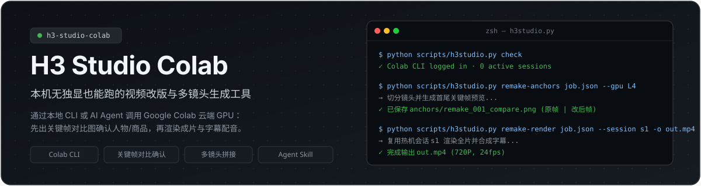
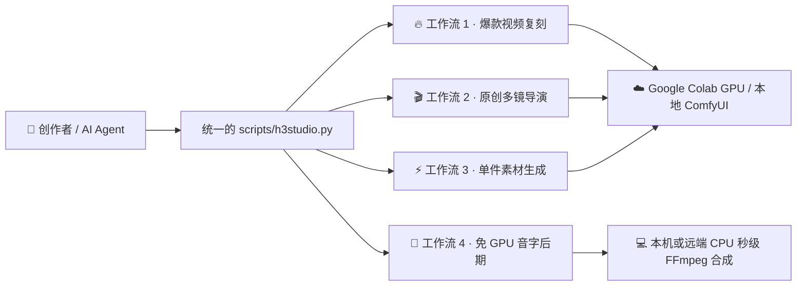
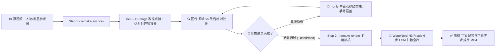

<div align="center">



<br />

**纯血 MiniMax H3 原生多模态生成 × WepeNerd H3 Ripple 两步确认式爆款视频复刻**  
通过 Google Colab CLI 一键调度云端 GPU（或直连本地 ComfyUI），面向 AI Agent 与创作者的可复现视频工程套件

<p>
  <a href="https://github.com/Kiteflyingee/h3-studio-colab/actions/workflows/ci.yml">
    
  </a>
  
  
  
  
  <a href="LICENSE">
    
  </a>
</p>

<p>
  <a href="#highlights">核心亮点</a> ·
  <a href="#quickstart">快速安装</a> ·
  <a href="#architecture">黄金流程架构</a> ·
  <a href="#workflows">四大工作流</a> ·
  <a href="#cli-reference">CLI 速查表</a> ·
  <a href="#gpu-matrix">GPU 选型</a> ·
  <a href="#project-layout">目录与文档</a>
</p>

</div>

---

<a id="highlights"></a>

## ✨ 核心亮点

<table>
  <tr>
    <td width="50%" valign="top">
      <h3>🎯 两步确认式爆款复刻（省时省算力）</h3>
      <p>告别整片盲抽废片。<b>Step 1</b> 使用 <code>P-H3-Image</code> 修改每镜首尾锚点，经 <code>QwenEditAlignComposite</code> 仿射对齐并逐像素锁死未改动背景，几十秒回传<b>「原帧 | 改后帧」对比图</b>确认形象；<b>Step 2</b> 复用热机经 <code>WepeNerd H3 Ripple</code> <b>6 步 LCM</b> 扩散全片并合成音字。</p>
    </td>
    <td width="50%" valign="top">
      <h3>🧬 纯血 MiniMax H3 全模态底座</h3>
      <p>摒弃碎片化拼凑节点，统一收敛至原生多模态矩阵：<code>FL2VA</code>（文/首尾帧音画同出）、<code>Ref2VA</code>（多图/视频/音色自由参考）、<code>Guides</code>（按秒卡点引导）、<code>Control</code>（控制视频约束）、<code>P-H3-Image</code>（8 图参考精修）与 <code>TTS-32</code>（多参考音色克隆）。</p>
    </td>
  </tr>
  <tr>
    <td width="50%" valign="top">
      <h3>☁️ Colab 热机驻留与 GPU 智能适配</h3>
      <p>单一入口 <a href="scripts/h3studio.py"><code>scripts/h3studio.py</code></a> 全权托管 Colab 会话生命周期，默认空闲驻留 <b>15 分钟</b>免重复加载数十 GB 权重；针对 <code>A100</code> 自动切换 <code>fp16</code> 视频 VAE 规避 int8 解码异常，<code>G4 / A100 / H100</code> 自动启用 <code>720P</code> 甜点分辨率。</p>
    </td>
    <td width="50%" valign="top">
      <h3>🔒 供应链级锁定与断点续跑恢复</h3>
      <p><a href="models/catalog.json"><code>models/catalog.json</code></a> 与 <a href="dependencies.lock.json"><code>dependencies.lock.json</code></a> 逐文件锁定 Hugging Face <code>revision</code>、字节数、<code>SHA256</code> 与自定义节点 commit；支持 <code>--resume</code> 断线恢复、<code>--only</code> 单锚点秒级重抽与跨平台无 <code>libass</code> 透明 PNG 字幕兜底合成。</p>
    </td>
  </tr>
</table>

---

<a id="quickstart"></a>

## 📦 一分钟安装与接入

### 方式 A：安装为 AI Agent 技能（推荐）

兼容 **Antigravity、Claude Code、Codex、Cursor** 等支持 `.agents/skills` 规范的编码与创作 Agent。克隆后即可在对话中通过 `/h3-studio-colab` 或自然语言直接驱动全流程：

```bash
# 安装到当前工作区
git clone https://github.com/Kiteflyingee/h3-studio-colab.git .agents/skills/h3-studio-colab

# 或安装到全局技能目录（所有项目通用）
git clone https://github.com/Kiteflyingee/h3-studio-colab.git ~/.agents/skills/h3-studio-colab
```

<details>
<summary>💬 <b>点击查看对话唤醒话术示例</b></summary>

- **同镜换人 / 换商品复刻**：
  > 「用 `/h3-studio-colab` 把 `source.mp4` 里的女主换成这张参考图，手里护肤品换成 `product.png`，保持原片运镜和背景，先出关键帧对比图给我确认。」
- **真人爆款转 2D 动画 / 拟人猫重制**：
  > 「参考这两只猫咪角色设定图，把这条真人短剧复刻成 720P 2D 动画风短片，保留原片剧情节奏与音轨。」
- **从零多镜头原创短片**：
  > 「帮我编排一条 3 镜头的赛博雨夜侦探短片，先锁主角设定图，确认后用 Colab G4 渲染合成成片。」

</details>

### 方式 B：命令行独立使用

本机仅需 **Python 3.10+**、`ffmpeg` 与已登录的 [`google-colab-cli`](https://pypi.org/project/google-colab-cli/)（本地无需显卡）：

```bash
# 1. 安装本机轻量依赖与 Colab CLI
pip install -r requirements.txt
uv tool install google-colab-cli && colab auth login

# 2. 检查 Colab 登录态、剩余计算单元与离线构图契约
python scripts/h3studio.py check
python scripts/h3studio.py plan examples/basic-v3.json
python scripts/h3studio.py doctor --manifest examples/basic-v3.json --offline
```

---

<a id="architecture"></a>

## 🧭 架构与「两步确认」黄金流程

### 1. 四大创作流水线总览



### 2. 爆款复刻「两步确认式」闭环（`remake-anchors` → `remake-render`）



> [!IMPORTANT]
> **算力防误触门禁**：在默认同镜改版模式（`"mode": "edit"`）下，若尚未执行 `remake-anchors` 产出关键帧预览，直接运行 `remake-render` 会被自动拦截，防止未经形象确认直接消耗多镜头视频算力。

---

<a id="workflows"></a>

## 🎬 四大标准工作流

### 工作流 1：🔥 爆款视频复刻（换人 / 换商品 / 跨画风重制 / 批量改文案）

根据复刻幅度自动匹配三条最优执行路径：

| 复刻子模式 | `mode` 配置 | 核心机制 | 是否需要两步确认 |
| :--- | :---: | :--- | :---: |
| **同镜精准改版**（默认） | `"edit"` | `P-H3-Image` 精修首尾锚点 + 仿射锁死背景 → `H3 Ripple` **6 步 LCM** 全段传播，完整保留原片运镜与背景 | **是**（先跑 `remake-anchors`） |
| **跨画风 / 跨物种重制** | `"recreate"` | 自动将快切短镜合并为 `6.0–9.4s` 黄金段、生成 `640p` 静音参考代理提速 4 倍，经 `Ref2VA` 重绘全片 | 否（直跑 `remake-render`） |
| **纯改字幕 / 叠字变体** | 仅填 `copy` | 省略人物与商品参考项时自动识别为纯后期改版，免 GPU 在 CPU 秒级批量出多版本成片 | 否（免 GPU 直出） |

```bash
# Step 1：切分镜头并生成改后锚点与「原帧 | 改后帧」左右对比图（*_compare.png）
python scripts/h3studio.py remake-anchors examples/remake-v3.json --gpu L4 --allow-unverified

# （可选）若仅第 1 镜首帧锚点想换个抽卡结果，秒级单张重抽：
python scripts/h3studio.py remake-anchors examples/remake-v3.json --session <SESSION> --only remake_001_anchor1 --allow-unverified

# Step 2：确认形象无误后，复用同一热机会话 6 步扩散全片并合成配音/字幕
python scripts/h3studio.py remake-render examples/remake-v3.json --session <SESSION> --confirmed --allow-unverified --output final.mp4
```

<details>
<summary>📄 <b>点击展开爆款复刻配置示例（<code>examples/remake-v3.json</code>）</b></summary>

```json
{
  "source_video": "assets/source.mp4",
  "mode": "edit",
  "resolution": "480P",
  "characters": [
    {
      "target_id": "the woman on the left wearing a red coat",
      "reference": "assets/character.png",
      "prompt": "Keep natural pose and expression."
    }
  ],
  "products": [
    {
      "target_id": "the bottle in her right hand",
      "reference": "assets/product.png",
      "prompt": "Preserve the product shape and original hand grip."
    }
  ],
  "preserve": ["camera", "background", "timing", "audio"],
  "copy": {
    "subtitles": [{"start": 0, "end": 4, "text": "替换后的准确字幕"}],
    "in_scene_text": [{"start": 0, "end": 4, "text": "NEW PRODUCT", "x": 20, "y": 50, "font_size": 32}],
    "clear_regions": [],
    "dialogue": []
  },
  "variants": [
    {"name": "version_a"},
    {"name": "version_b", "copy": {"subtitles": [{"start": 0, "end": 4, "text": "第二版文案"}]}}
  ]
}
```

</details>

---

### 工作流 2：🎬 原创多镜头导演（剧本 → 交互时间线 → 连拍成片）

适合从故事创意出发，先锁定角色/场景设定图，再编译生成可离线预览微调的 `timeline.html`，最后在云端一键渲染分镜并拼接成片（相邻镜头支持设置 `"continue_previous": true` 无缝接续动作）：

```bash
# 1. 编译剧本并产出离线交互式时间线（timeline.html）与底层清单
python scripts/h3studio.py director-compile examples/director_example.json

# 2. 确认分镜规格后，调度云端 GPU 渲染全部分镜并直出成片
python scripts/h3studio.py director-render examples/director_example.json --gpu G4 --confirmed --allow-unverified --output story_final.mp4
```

---

### 工作流 3：⚡ 单件多模态素材生成（图 / 音画视频 / 锚点扩散 / 配音）

编写标准任务清单 `{"jobs": [...]}` 并通过 `h3studio.py run` 统一调度，支持任务间 `@任务ID` 上下游串联与局部重跑：

| 目标产物 | 任务类型与模式（`type` / `mode`） | 核心能力说明 | 默认锁定配置（`profile`） |
| :--- | :--- | :--- | :--- |
| **静态图像** | `type: "image"` | 文生图或最多 8 张 `@图片N` 多参考精修；设 `align_to_first: true` 可逐像素锁死首图背景 | `ph3-lora-int8`<br>*(轻量可选 `ph3-standalone-w4a8`)* |
| **无参考视频** | `type: "video"`<br>`mode: "text" \| "frames"` | 纯文生音画视频，或将单/双张图精准钉死为**首帧 / 尾帧**（`first` / `last`） | `h3-fl2va-int8` |
| **多参考视频** | `type: "video"`<br>`mode: "ref" \| "guides" \| "control"` | 自由融合角色图/参考视频/音色（`ref`）、指定秒数卡画面（`guides`）、结构控制视频（`control`）或单段续拍（`extend` ≤ 15s） | `h3-ref2va-int8` / `h3-guides` / `h3-control-union`<br>*(加速可选 `fasth3-omni-int8`)* |
| **关键帧传播** | `type: "video_edit"` | 对已切好的单段视频传入 1–16 张精修锚点帧 `anchors`，6 步 LCM 扩散全段 | `h3-ripple` |
| **旁白配音** | `type: "tts"` | 输入台词与最多 3 段参考音色 `voices`，生成 **2–15 秒**高自然度语音 | `h3-tts32-native` |

```bash
# 运行基础多模态清单
python scripts/h3studio.py run examples/basic-v3.json --gpu L4 --allow-unverified

# 仅重跑指定任务节点，并自动重算依赖它的下游节点
python scripts/h3studio.py run examples/advanced-v3.json --session <SESSION> --confirmed --allow-unverified --only animate --with-dependents
```

---

### 工作流 4：📝 免 GPU 后期音字合成（CPU 秒级出片）

无需占用 GPU 算力，通过 `--backend local`（或远端 CPU）秒级完成配音时段替换、原字幕区域擦除与新字幕烧录：

- **`voice_replace`**：将音频文件或上游 `@tts_id` 混入视频指定 `[start, end]` 秒区间（自动静音该时段原音轨并平滑衔接）。
- **`subtitle_replace`**：支持静态区域模糊/遮挡擦除（`clear_regions`）、时间轴字幕（`subtitles`）与画内固定坐标叠字（`overlays`）。
  - *跨平台兼容增强*：当 macOS Homebrew 标准版 `ffmpeg` 缺少 `libass` / `drawtext` 滤镜时，自动回退为高分透明 RGBA PNG 渲染 + FFmpeg `overlay` 管线，零额外编译开箱即用。

---

<a id="cli-reference"></a>

## 🛠️ CLI 全命令速查

所有功能均收敛于单一入口 `python scripts/h3studio.py <command>`：

| 分类 | 子命令 | 用途说明 |
| :--- | :--- | :--- |
| **会话管理** | `check` | 检查 `colab` CLI 登录状态、账户剩余计算单元（CU）与当前活跃实例 |
| | `sessions` | 列出运行中的 Colab GPU 会话名称、机型与空闲自动关机倒计时 |
| | `keep --session <NAME> --minutes 60` | 延长指定热机会话的空闲保活时间（上限 240 分钟） |
| | `stop --session <NAME>` / `stop --all` | 任务结束后立即释放指定或全部云端会话，避免空转扣点 |
| **爆款复刻** | `remake-analyze <request.json>` | 复刻前检：自动探测源视频镜头切点、帧率与各镜时长分布 |
| | `remake-anchors <request.json>` | **Step 1**：切镜抽取首尾锚点，运行 `P-H3-Image` 精修并下载左右对比图供人工确认 |
| | `remake-compile <request.json>` | 仅编译输出底层 H3 执行清单而不启动远端推理（便于审查调试） |
| | `remake-render <request.json>` | **Step 2**：校验已确认锚点，通过 `H3 Ripple` 6 步扩散全片并串联配音/字幕合片 |
| **多镜导演** | `director-compile <script.json>` | 将分镜剧本编译为 H3 任务清单与可视化离线时间线 `timeline.html` |
| | `director-render <script.json>` | 在云端按序渲染全部分镜并自动合成完整故事短片 |
| | `director-compose <script.json>` | 将本地已下载的 `out/<shot_id>.mp4` 离线拼接为最终成片 |
| **通用与诊断** | `run <manifest.json>` | 执行通用多模态清单（支持 `--resume`、`--only`、`--with-dependents`、`--backend local`） |
| | `plan <manifest.json>` | 只读解析任务依赖图、预估所需模型体积与执行拓扑 |
| | `doctor` / `models-plan` / `models-install` | 环境只读体检（支持 `--offline`）、缺失模型规划与按 SHA256 锁定安装 |

---

<a id="gpu-matrix"></a>

## ⚡ Colab GPU 选型与自适应策略

| GPU 档位 | 显存规格 | 未显式指定时的默认分辨率 | 视频 VAE 精度策略 | 推荐适用场景 |
| :---: | :---: | :---: | :---: | :--- |
| **`L4`** | 24 GB | `480P` | `int8`（省显存稳跑） | 日常锚点抽卡确认（`remake-anchors`）、`480P` 快速试跑、单件短片验证 |
| **`G4`** | 24 GB+ | **`720P`** | `int8` | 高性价比 **`720P` 多镜头爆款复刻**与角色动画重制主力机型 |
| **`A100`** | 40 / 80 GB | **`720P`** | **自动切换 `fp16`** | 高负载长镜头、`720P/1080P` 高画质成片（内置规避 A100 下 int8 VAE 解码花屏） |
| **`H100`** | 80 GB | **`720P`** | `int8` / `fp16` | 极速批量生产与多变体并发交付 |

> [!TIP]
> **省算力点数三原则**：
> 1. 首次跑新提示词或未实测配置时，先用 `480P` + `5 秒` 试跑单段验证效果；
> 2. 同一项目的 `remake-anchors` 与 `remake-render` 传入 `--session <NAME>` 复用同一台热机，省去二次拉起 ComfyUI 与加载权重的时间；
> 3. 全片交付确认无误后，顺手执行 `python scripts/h3studio.py stop --all` 立即归还算力。

---

<a id="project-layout"></a>

## 📂 工程目录与文档索引

```text
h3-studio-colab/
├── SKILL.md                     # AI Agent 技能路由定义（/h3-studio-colab 入口指令）
├── scripts/
│   ├── h3studio.py              # 唯一统一 CLI 入口
│   └── verify_release.py        # 离线全量发布验收套件（单测 + 构图导出 + 锁表校验）
├── studio/                      # 核心编排引擎
│   ├── adapters/                # ComfyUI 原生节点与 WepeNerd H3 Ripple 构图适配器
│   ├── remake.py                # 爆款复刻镜头切分、锚点规划与双模式编译器
│   ├── remake_remote.py         # 两步确认锚点对比图回传与门禁校验
│   ├── director.py              # 多镜头导演剧本编译与时间线合成
│   ├── colab_cli.py             # Google Colab CLI 会话管理与实时流式日志桥接
│   ├── copy_replace.py          # 字幕擦除烧录与跨平台 PNG overlay 自动兜底
│   └── audio_mix.py             # 多轨配音替换与音量包络混音
├── remote/
│   └── runner_v3.py             # 云端实例自举执行器（环境探测、节点校验、断点记录）
├── models/
│   └── catalog.json             # 模型仓库 revision、字节大小与 SHA256 严格锁表
├── examples/                    # 开箱即用的复刻、导演、基础/进阶多模态 JSON 模板
├── references/                  # 深入中文参考手册
│   ├── 简体中文操作指南.md
│   ├── 任务清单格式.md
│   ├── 提示词指南.md
│   ├── 新增工作流集成.md
│   └── 问题排查.md
├── acceptance/                  # 功能验收矩阵（区分离线契约通过 vs 真机 GPU 实测）
└── tests/                       # 88 项自动化单元测试与构图回归测试
```

📖 **深入阅读**：
- [简体中文操作指南](references/简体中文操作指南.md) · [任务清单完整字段规范](references/任务清单格式.md) · [多模态提示词指南](references/提示词指南.md) · [常见问题排查](references/问题排查.md)

---

## 🧪 发布验收与致谢许可

在提交修改或发布前，可在无 GPU 环境下运行完整离线契约验收套件（覆盖 88 项单元测试、ComfyUI API 图导出、字节码编译与离线 `plan` / `doctor` 校验）：

```bash
python scripts/verify_release.py
```

> [!NOTE]
> 离线验收通过代表工作流构图、参数契约与权重哈希锁表完整自洽；各模型配置在真实云端 GPU 上的实测画质验收进度详见 [`acceptance/功能验收.json`](acceptance/功能验收.json)。

### 上游致谢与许可

本项目代码以 **[MIT License](LICENSE)** 开源发布。运行时按锁定版本拉取的上游组件与模型权重遵循各自原始许可协议（详见 [`THIRD_PARTY_NOTICES.md`](THIRD_PARTY_NOTICES.md)）：

- **[Comfy-Org / ComfyUI](https://github.com/Comfy-Org/ComfyUI)** 与 **[workflow_templates](https://github.com/Comfy-Org/workflow_templates)** — 原生多模态节点运行时与工作流基座
- **[WepeNerd / ComfyUI-WepeNerd](https://github.com/WepeNerd/ComfyUI-WepeNerd)** & **[H3_Ripple](https://huggingface.co/WepeNerd/H3_Ripple)** — 6 步 LCM 关键帧视频传播与 `QwenEditAlignComposite` 仿射对齐合成节点
- **MiniMax H3 / P-H3-Image 系列权重发布者** — 原生音画视频、图像精修与语音生成底座模型
