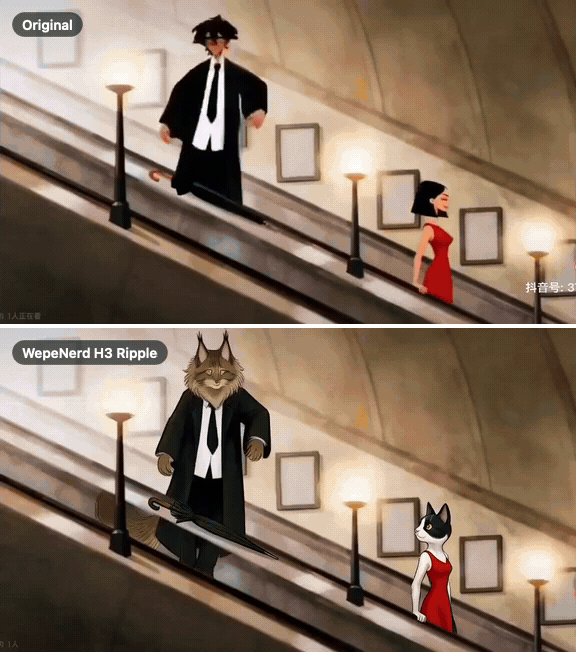
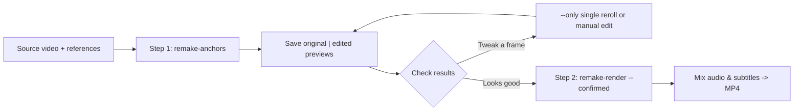

# H3 Studio Colab

<p align="center">
  
</p>

<p align="center">
  <a href="https://github.com/Kiteflyingee/h3-studio-colab/actions/workflows/ci.yml"></a>
  
  
  <a href="LICENSE"></a>
</p>

<p align="center">
  <b>English</b> · <a href="README.zh-CN.md">简体中文</a>
</p>

Run **character/product video remakes, multi-shot storyboard generation, voiceover synthesis, and subtitle replacement** on Google Colab GPUs (or against a local runtime via `--backend local`).

It works in two ways out of the box:
- **As an AI Agent Skill / Plugin**: install into Claude Code, Codex, Antigravity, Cursor, or any `SKILL.md`-compatible client, then trigger workflows from chat via `/h3-studio-colab`, `$h3-studio-colab`, or plain prompts.
- **As a standalone CLI**: run [`scripts/h3studio.py`](scripts/h3studio.py) directly from your terminal for manual control over jobs, parameters, and GPU sessions.

<p align="center">
  
  <br />
  <sub>Live remake demo: two-step keyframe alignment + 6-step propagation (Top: original clip · Bottom: two-cat character replacement, preserving frame-by-frame motion and background)</sub>
</p>

---

## Why This Exists

Running video workflows manually inside browser-based Colab notebooks gets repetitive fast: every fresh session requires setting up custom nodes and downloading tens of gigabytes of weights, browser disconnects lose state, and full-video remakes often burn compute units before you notice a drifted face or warped background halfway through the clip.

`h3-studio-colab` wraps that workflow into a single local entrypoint, [`scripts/h3studio.py`](scripts/h3studio.py):

- **Two-step video remakes (check frames before rendering video)**: Step 1 (`remake-anchors`) splits the source video into shots and edits only the start/end keyframes, downloading lightweight `original | edited` comparison previews (`*_compare.jpg`) within seconds while affine-aligning and restoring untouched background pixels. Re-roll individual anchors with `--only` or edit the PNGs by hand, then run Step 2 (`remake-render`) to propagate across the full video.
- **15-minute warm session reuse & minimal proxy traffic**: Colab instances stay alive for 15 minutes after a batch so the next command (`--session`) reuses models already loaded in VRAM. Uploads and downloads are deduplicated and intermediate files stay on the worker until final delivery. Run `stop --all` anytime to shut down immediately.
- **Standalone single-asset jobs & zero-GPU post-processing**: image generation/editing, first/last-frame or multi-reference video generation, voiceover synthesis, timed audio mixing, and static subtitle erasure/burn-in can each run on their own. Subtitle-only and audio-mix jobs run locally on CPU without spinning up a GPU (automatically falling back to transparent RGBA PNG overlays on macOS when Homebrew `ffmpeg` lacks `libass`/`drawtext`).
- **Pinned weight hashes & crash recovery**: [`models/catalog.json`](models/catalog.json) and [`dependencies.lock.json`](dependencies.lock.json) pin model revisions, SHA256 digests, and custom-node commits so upstream updates do not break existing pipelines; interrupted runs resume with `--resume`.

---

## Installation & Setup

Whether you invoke this through an AI Agent or run the CLI yourself, your local machine needs **Python 3.10+**, `ffmpeg`, and an authenticated [`google-colab-cli`](https://pypi.org/project/google-colab-cli/):

```bash
uv tool install google-colab-cli
colab auth login
```

### Option 1: Install as a Plugin or AI Agent Skill

This repository uses a **dual-compatible Plugin + Skill layout**, shipping manifests for Claude Code ([`.claude-plugin/`](.claude-plugin)), Codex ([`.codex-plugin/`](.codex-plugin) and [`agents/openai.yaml`](agents/openai.yaml)), and Antigravity ([`plugin.json`](plugin.json)) alongside a root [`SKILL.md`](SKILL.md):

| Client | Plugin Command / Path | Standalone Skill Path | Chat Invocation |
| :--- | :--- | :--- | :--- |
| **Claude Code** | `/plugin marketplace add Kiteflyingee/h3-studio-colab` | `~/.claude/skills/h3-studio-colab` (project: `.claude/skills/`) | `/h3-studio-colab` or natural language |
| **Codex** | `$skill-installer install https://github.com/Kiteflyingee/h3-studio-colab` | `~/.codex/skills/h3-studio-colab` (project: `.agents/skills/`) | `$h3-studio-colab` or natural language |
| **Antigravity** | `~/.gemini/config/plugins/h3-studio-colab` | `~/.gemini/config/skills/h3-studio-colab` (workspace: `.agents/skills/`) | `/h3-studio-colab` or natural language |

**Claude Code**

Add the repository as a plugin marketplace and install directly from the Claude Code prompt (run `pip install Pillow huggingface_hub` once in your local Python environment before first use):

```text
/plugin marketplace add Kiteflyingee/h3-studio-colab
/plugin install h3-studio-colab@h3-studio-colab
```

Or clone manually into your skills directory:

```bash
git clone https://github.com/Kiteflyingee/h3-studio-colab.git ~/.claude/skills/h3-studio-colab
pip install -r ~/.claude/skills/h3-studio-colab/requirements.txt
```

**Codex**

Install directly from chat using the built-in skill installer:

```text
$skill-installer install https://github.com/Kiteflyingee/h3-studio-colab
```

Or clone manually into `~/.codex/skills/` (use `.agents/skills/h3-studio-colab` for repo-scoped setup):

```bash
git clone https://github.com/Kiteflyingee/h3-studio-colab.git ~/.codex/skills/h3-studio-colab
pip install -r ~/.codex/skills/h3-studio-colab/requirements.txt
```

**Antigravity**

Install as a full Plugin into your global plugins folder (shows the icon, starter prompts, and a single enable/disable toggle in the Customizations panel):

```bash
git clone https://github.com/Kiteflyingee/h3-studio-colab.git ~/.gemini/config/plugins/h3-studio-colab
pip install -r ~/.gemini/config/plugins/h3-studio-colab/requirements.txt
```

Or install as a workspace-scoped Skill inside the current project:

```bash
git clone https://github.com/Kiteflyingee/h3-studio-colab.git .agents/skills/h3-studio-colab
pip install -r .agents/skills/h3-studio-colab/requirements.txt
```

**Universal `skills` CLI**

```bash
npx skills add Kiteflyingee/h3-studio-colab
```

**Using it in Agent Chat**

Once installed, invoke the skill command or pass your source video and reference images in chat. The agent follows [`SKILL.md`](SKILL.md) to build job manifests and run the CLI:

- **Character / product swap**: e.g., *"Replace the lead actor in `source.mp4` with `role.png` and swap the bottle in her hand with `product.png`, keeping the original camera motion and background."* The agent runs Step 1 first and pauses to show you `original | edited` keyframe previews instead of burning GPU credits on the whole video upfront; ask it to re-roll any single frame, then confirm to render the final video on the same warm session.
- **Style remakes & original storyboards**: e.g., *"Recreate this clip in a 720P 2D animated style using these two character sheets"*, or *"Turn this 3-shot script into a short video — compile the timeline for me to check first."*
- **Compute guardrails & session cleanup**: before rendering 2 or more video shots, the agent confirms shot count and resolution with you, and asks whether to keep or stop the Colab session once rendering finishes.

### Option 2: Standalone CLI Installation

To run everything manually from a terminal without an AI Agent:

```bash
git clone https://github.com/Kiteflyingee/h3-studio-colab.git
cd h3-studio-colab
pip install -r requirements.txt

# Verify Colab login status and remaining compute units
python scripts/h3studio.py check
```

---

## Common Workflows

### 1. Character / Product Video Remake

Copy [`examples/remake-v3.json`](examples/remake-v3.json) and point it at your source video, character/product reference images, and optional subtitle replacements:



```bash
# Step 1: Split shots and generate side-by-side keyframe previews (*_compare.jpg)
python scripts/h3studio.py remake-anchors examples/remake-v3.json --gpu L4 --allow-unverified

# Optional: re-roll a single anchor frame on the same warm session
python scripts/h3studio.py remake-anchors examples/remake-v3.json --session <SESSION> --only remake_001_anchor1 --allow-unverified

# Step 2: Once anchors look right, reuse the warm session to render the full video
python scripts/h3studio.py remake-render examples/remake-v3.json --session <SESSION> --confirmed --allow-unverified --output final.mp4
```

Notes:
- **Full style recreation (e.g., live-action video to 2D animated characters)**: set `"mode": "recreate"` in the JSON config. Step 1 anchor alignment is skipped; short cuts are automatically packed into `6–9.4s` segments with a `640p` silent reference proxy, so you can run `remake-render` directly.
- **Subtitle / on-screen text edits only**: omit `characters` and `products` and provide only `copy` to render variants locally on CPU without using GPU credits.

<details>
<summary>View <code>examples/remake-v3.json</code> example config</summary>

```json
{
  "source_video": "assets/source.mp4",
  "mode": "edit",
  "resolution": "480P",
  "characters": [
    {
      "target_id": "the woman on the left wearing a red coat",
      "reference": "assets/character.png",
      "prompt": "Keep natural pose and expression."
    }
  ],
  "products": [
    {
      "target_id": "the bottle in her right hand",
      "reference": "assets/product.png",
      "prompt": "Preserve the product shape and original hand grip."
    }
  ],
  "preserve": ["camera", "background", "timing", "audio"],
  "copy": {
    "subtitles": [{"start": 0, "end": 4, "text": "Updated subtitle line"}],
    "in_scene_text": [{"start": 0, "end": 4, "text": "NEW PRODUCT", "x": 20, "y": 50, "font_size": 32}],
    "clear_regions": [],
    "dialogue": []
  }
}
```

</details>

### 2. Multi-Shot Storyboard Video

Write a multi-shot script to compile a local interactive `timeline.html` first (set `"continue_previous": true` on adjacent shots for continuous motion), inspect timing locally, and then render and stitch on Colab:

```bash
python scripts/h3studio.py director-compile examples/director_example.json
python scripts/h3studio.py director-render examples/director_example.json --gpu G4 --confirmed --allow-unverified --output story.mp4
```

### 3. Single-Asset Generation & Post-Processing

Write a `{"jobs": [...]}` manifest (see [`examples/basic-v3.json`](examples/basic-v3.json) and [`examples/advanced-v3.json`](examples/advanced-v3.json)) and execute it with `run`. Downstream jobs can reference upstream outputs via `@job_id`:

```bash
python scripts/h3studio.py run examples/basic-v3.json --gpu L4 --allow-unverified

# Re-run a single job node and automatically update downstream dependents
python scripts/h3studio.py run examples/advanced-v3.json --session <SESSION> --confirmed --allow-unverified --only animate --with-dependents
```

Supported job `type` values:
- `image`: text-to-image or multi-reference editing (up to 8 reference images; `align_to_first: true` locks untouched background pixels to the first image).
- `video`: supports text-only (`text`), pinned start/end frames (`frames`), multi-asset references (`ref`), timestamped visual guides (`guides`), structural control video (`control`), and clip continuation (`extend`).
- `video_edit`: propagates 1–16 edited `anchors` across a pre-cut video clip.
- `tts`: generates 2–15s speech from text and up to 3 reference voice clips.
- `voice_replace` / `subtitle_replace`: mixes audio into `[start, end]` intervals, erases static subtitle regions, and burns in new subtitles or fixed text overlays.

---

## Colab Sessions & GPU Tips

```bash
python scripts/h3studio.py sessions                            # List active Colab sessions & idle countdowns
python scripts/h3studio.py keep --session <NAME> --minutes 60  # Extend warm-session retention (up to 240m)
python scripts/h3studio.py stop --all                          # Shut down all active sessions immediately
```

- **Choosing a GPU**: `L4` (defaults to `480P`) is the most economical choice for prompt tests and `remake-anchors` previews; use `G4` or `A100` for `720P` multi-shot renders (`G4 / A100 / H100` default to `720P` when resolution is unspecified).
- **Automatic A100 VAE handling**: `int8` video VAE decoding can produce artifacts on `A100`; passing `--gpu A100` automatically switches the video VAE to `fp16` with no manual config changes required.

---

## CLI Subcommand Reference

| Subcommand | Description |
| :--- | :--- |
| `check` | Verify `colab` CLI login status, remaining compute units, and active sessions |
| `sessions` / `keep` / `stop` | Inspect, extend retention of, or immediately terminate Colab GPU sessions |
| `remake-analyze` | Inspect source video shot cuts, frame rate, and segment durations |
| `remake-anchors` | Remake Step 1: split shots and generate `original \| edited` keyframe previews |
| `remake-compile` | Compile the underlying remake job manifest locally without remote execution |
| `remake-render` | Remake Step 2: propagate confirmed keyframes across shots and mix audio/subtitles |
| `director-compile` / `director-render` / `director-compose` | Compile storyboard `timeline.html`, render shots on Colab, or stitch local clips |
| `run` | Execute a general single-asset or post-processing manifest (`--resume`, `--only`, `--backend local`) |
| `plan` / `doctor` / `models-plan` / `models-install` | Offline execution planning, environment diagnostics, and SHA256-verified weight installation |

---

## Repository Layout & Local Testing

```text
h3-studio-colab/
├── plugin.json               # Antigravity plugin manifest
├── .claude-plugin/           # Claude Code plugin & marketplace.json config
├── .codex-plugin/            # Codex plugin manifest
├── agents/openai.yaml        # Codex / OpenAI skill UI card config
├── SKILL.md                  # Root single-skill instructions
├── skills/h3-studio-colab/   # Plugin-mode skill bundle & CLI forwarding shim
├── README.zh-CN.md           # Simplified Chinese README
├── scripts/
│   ├── h3studio.py           # Unified CLI entrypoint
│   └── verify_release.py     # Offline unit-test & graph contract suite
├── studio/                   # Local orchestration, shot splitting, Colab transport & FFmpeg post
├── remote/runner_v3.py       # Remote Colab bootstrap & ComfyUI queue runner
├── models/catalog.json       # Pinned model revisions, byte sizes, and SHA256 digests
├── examples/                 # Ready-to-edit JSON job templates
├── references/               # Detailed schema, prompt, and troubleshooting guides (zh-CN)
├── acceptance/               # Offline contract vs. live-GPU verification matrix
└── tests/                    # Automated unit tests
```

Run the full offline verification suite locally (no GPU required):

```bash
python scripts/verify_release.py
```

---

## Credits & License

Source code in this repository is released under the [MIT License](LICENSE). Upstream frameworks, custom nodes, and model weights fetched at runtime remain under their respective authors' licenses (see [`THIRD_PARTY_NOTICES.md`](THIRD_PARTY_NOTICES.md)):

- [ComfyUI](https://github.com/Comfy-Org/ComfyUI) and [workflow_templates](https://github.com/Comfy-Org/workflow_templates) — node execution runtime and official workflow templates
- [ComfyUI-WepeNerd](https://github.com/WepeNerd/ComfyUI-WepeNerd) (`H3_Ripple` / `QwenEditAlignComposite`) — keyframe video propagation and affine alignment compositing nodes
- MiniMax H3 / P-H3-Image model authors — video, image editing, and speech synthesis weights
